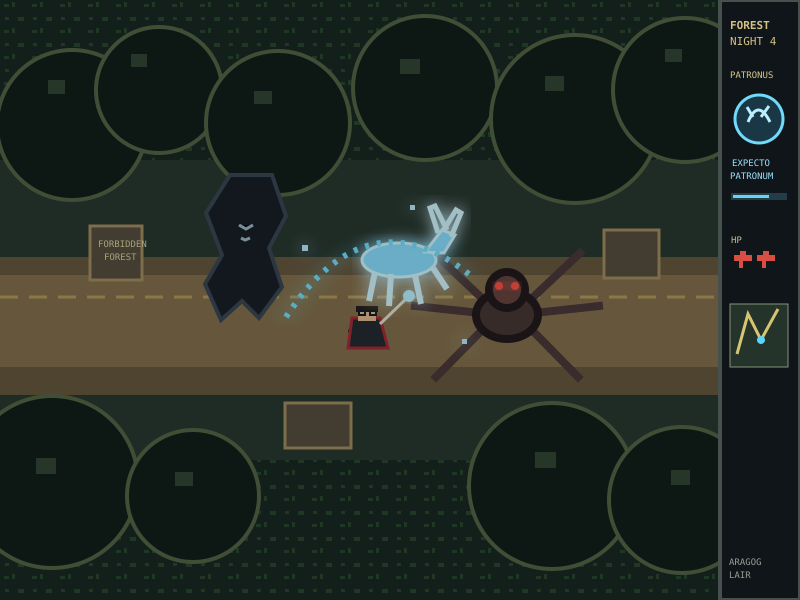
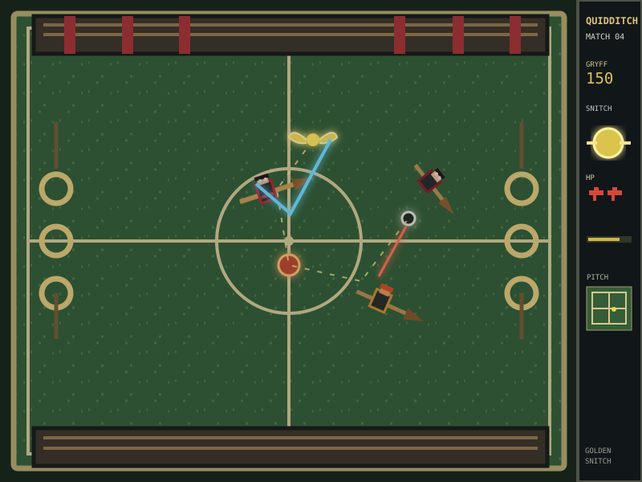
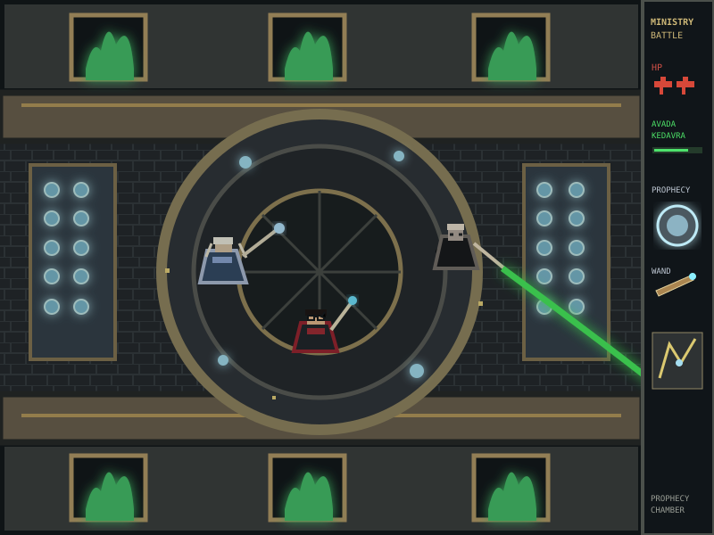

# Harry Potter: Hex District

Non-commercial fan-game project: a portrait, one-thumb Android survival roguelite set in the recognizable Harry Potter universe. The game text is available in Russian and English.

The repository contains a **playable Godot 4.3 game** next to the design documents, the painted master art and the earlier visual references.

## The Game

- Engine: Godot 4.3 (GDScript, GL Compatibility renderer), portrait, rendered at the device's native resolution.
- One thumb only: touch the lower part of the screen and drag to move; every spell targets and fires by itself. Keyboard WASD/arrows work on desktop as a test aid.
- Story mode with 15 stages: ten chapters and five story-boss arenas (Quirrell, the Basilisk, a Dementor, Nagini, Voldemort).
- Endless mode: chapters loop and get harder; the best result is saved.
- Three heroes: Harry, Hermione and Ron, each with a different starting spell and stats.
- 28 automatic spells, 6 passives, 9 fusions made of two to four spells, 3 evolutions and 12 elemental synergies. The Combos menu lists all of them and shows what the current build has.
- Galleons are kept between runs and buy permanent upgrades and heroes.
- Pseudo-3D arenas with weather, particles and glow; painted heroes, bosses, enemies and floors are sliced from [`assets/visual-kit/`](assets/visual-kit/) when the game is built. Anything without a usable painted sprite is drawn in code.
- Procedural music and sound effects; no audio files.
- Bestiary, how-to-play screen, first-run hints, pause, settings, local save with a per-stage checkpoint.

### Run it

1. Install [Godot 4.3](https://godotengine.org/download/archive/4.3-stable/) (standard build).
2. Optional, for painted art: `godot --headless --path . -s res://tools/build_sprites.gd`
3. Open `project.godot` in the editor and press **F5**, or run `godot --path .` from the repository root.

### Android APK

The `build` GitHub Actions workflow (`.github/workflows/build.yml`) runs on pull requests and on pushes to `main` that touch code:

1. builds the runtime art from `assets/visual-kit`, imports the project and runs the headless smoke test (`tests/smoke_test.gd`: a bot plays the story and endless mode, and every menu is opened in both languages);
2. exports a debug APK and uploads it as the `hex-district-debug-apk` artifact of the run (Actions tab -> latest `build` run -> Artifacts).

The APK is a debug build signed with the CI debug keystore. It is for testing only and is not the release signing identity for future app updates. Run the smoke test locally with:

```
godot --headless --path . -s res://tools/build_sprites.gd
godot --headless --path . --import
godot --headless --path . -s res://tests/smoke_test.gd
```

For release signing, set up the persistent signing key as GitHub Actions secrets and use the same package name, keystore and key for every update. See [ANDROID_SIGNING.md](ANDROID_SIGNING.md). Do not commit the keystore or passwords.

### Code map

| Path | Role |
|---|---|
| `scripts/main.gd` | Entry point; wires world, HUD, joystick, audio and save |
| `scripts/game/world.gd` | Simulation step, collisions, statuses and synergies, rendering layers |
| `scripts/game/arsenal.gd` | Automatic spells and fusions |
| `scripts/game/director.gd` | Waves, elites, hazards, boss patterns, duels, endless mode |
| `scripts/game/arena.gd`, `render.gd`, `art.gd` | Arena layouts, pseudo-3D helpers, code-drawn and painted actors |
| `scripts/data/*.gd` | Stages, enemies and bosses, spells, fusions, heroes, upgrades |
| `scripts/core/*.gd` | Translations, sprite loader, save, procedural music and sound |
| `scripts/ui/*.gd` | One-thumb joystick, HUD strip and menu panels |
| `tools/build_sprites.gd` | Slices the master art into runtime sheets (`art/gen/`, not stored in git) |
| `tests/smoke_test.gd` | Headless bot test used by CI |

See [HANDOFF.md](HANDOFF.md) for the verified status, known limits and next steps.

## Design and Agent Brief

- [CONCEPT.md](CONCEPT.md) — game concept, world, spells and survival loop.
- [PROMPT_FOR_AGENT.md](PROMPT_FOR_AGENT.md) — autonomous implementation prompt for coding agents.
- [HANDOFF.md](HANDOFF.md) — persistent status, verified work and next implementation action.
- [ANDROID_SIGNING.md](ANDROID_SIGNING.md) — Android release-signing key, GitHub Actions secrets and in-place update requirements.
- [assets/visual-kit/VISUAL_BIBLE.md](assets/visual-kit/VISUAL_BIBLE.md) — the painted master art and how it is meant to be used.

## Earlier Overhead Level Concepts

| Chapter | Concept board |
|---|---|
| Diagon Alley |  |
| Hogwarts Courtyard |  |
| Forbidden Forest |  |
| Quidditch Pitch |  |
| Ministry of Magic |  |

- [Harry Potter — top-down player sprite sheet](refs/character_harry_topdown.svg)
- [Enemy roster — top-down sheet](refs/enemies_topdown.svg)

These are hand-authored vector concept boards. The painted masters in `assets/visual-kit/` replace them as the current visual direction.

## User-Supplied Style References (preserved unchanged)

The source screenshots in [`refs/source_examples/`](refs/source_examples/) anchor the dense GTA 2-like overhead city composition and the Crimsonland-like top-down survival combat. Use them to guide tone and readability; do not copy their artwork, maps, UI or assets.

- [GTA2 — dense city street](refs/source_examples/01_gta2_city_street.png)
- [GTA2 — city intersection/bridge](refs/source_examples/02_gta2_city_bridge.png)
- [GTA2 — industrial overhead road](refs/source_examples/03_gta2_industrial_road.png)
- [Crimsonland — ring attack](refs/source_examples/04_crimsonland_bullet_ring.png)
- [Crimsonland — forest creature swarm](refs/source_examples/05_crimsonland_forest_swarm.png)
- [Crimsonland — spell/creature swarm](refs/source_examples/06_crimsonland_spell_swarm.png)
- [Crimsonland — projectile combat](refs/source_examples/07_crimsonland_projectile_attack.png)
- [Crimsonland — snowfield swarm](refs/source_examples/08_crimsonland_snowfield_swarm.png)

Earlier schematic diagrams are under [`refs/archive_previous/`](refs/archive_previous/). `refs/.gdignore` only tells Godot not to import this folder.

> This is a fan game, not an endorsement by the rights holders. Confirm asset rights and licensing before any public or commercial release.
