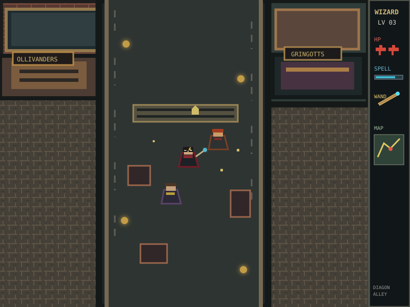
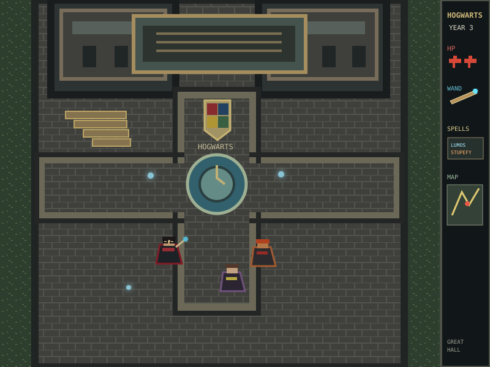

# Harry Potter: Hex District

Private, non-commercial fan-game project: a portrait, one-thumb Android survival roguelite set in the recognizable Harry Potter universe. Controls and game information are in English.

The repository now contains a **playable Godot 4.3 prototype** next to the original design and visual reference package.

## Playable Prototype

- Engine: Godot 4.3 (GDScript, GL Compatibility renderer), portrait 480x854 low-resolution viewport scaled up for a crunchy look.
- One thumb only: touch the lower 60% of the screen and drag to move; every spell targets and fires by itself. Keyboard WASD/arrows work on desktop as a test aid.
- Five chapters in order, each with its own layout, enemy mix, hazard and boss: Diagon Alley, Hogwarts Courtyard, Forbidden Forest, Quidditch Pitch, Ministry of Magic.
- Eight automatic spells, six passives, three evolutions, XP pickups with a magnet radius, three-card level-up screen, pause, settings, local save with a per-chapter checkpoint.
- All sprites are drawn in code from primitives; there are no imported art or audio files yet.

### Run it

1. Install [Godot 4.3](https://godotengine.org/download/archive/4.3-stable/) (standard build).
2. Open `project.godot` in the editor and press **F5**, or run `godot --path .` from the repository root.

### Android APK

The `build` GitHub Actions workflow (`.github/workflows/build.yml`) runs on every push to `main` that touches code:

1. imports the project and runs the headless smoke test (`tests/smoke_test.gd`, a bot plays all five chapters);
2. exports a debug APK and uploads it as the `hex-district-debug-apk` artifact of the run (Actions tab -> latest `build` run -> Artifacts).

The APK is currently a debug build signed with the CI debug keystore. It is for testing only and is not the release signing identity for users' future app updates. Run the smoke test locally with:

```
godot --headless --path . -s res://tests/smoke_test.gd
```

For release signing, set up the persistent signing key as GitHub Actions secrets and use the same package name, keystore and key for every update. See [ANDROID_SIGNING.md](ANDROID_SIGNING.md) for the required secret names, safe handling and update rules. Do not commit the keystore or passwords.

### Code map

| Path | Role |
|---|---|
| `scripts/main.gd` | Entry point; wires world, HUD, joystick, audio and save |
| `scripts/game/world.gd` | Simulation step, collisions, arena layouts, world rendering |
| `scripts/game/arsenal.gd` | Automatic spells |
| `scripts/game/director.gd` | Waves, elites, chapter hazards, boss patterns |
| `scripts/game/art.gd` | Code-drawn Harry and enemy sprites |
| `scripts/data/*.gd` | Chapters, enemies/bosses, spells/passives/evolutions |
| `scripts/ui/*.gd` | One-thumb joystick, HUD strip and menu panels |
| `scripts/core/*.gd` | Local save and procedural sound effects |
| `tests/smoke_test.gd` | Headless bot test used by CI |

See [HANDOFF.md](HANDOFF.md) for the verified status, known limits and next steps.

## Design and Agent Brief

- [CONCEPT.md](CONCEPT.md) — game concept, world, spells, survival loop and five campaign chapters.
- [PROMPT_FOR_AGENT.md](PROMPT_FOR_AGENT.md) — autonomous implementation prompt; the coding agent is told not to ask the user to make project decisions.
- [HANDOFF.md](HANDOFF.md) — persistent status, verified work and next implementation action.
- [ANDROID_SIGNING.md](ANDROID_SIGNING.md) — permanent Android release-signing key, GitHub Actions secrets and in-place update requirements.

## New Overhead Level Concepts

| Chapter | Concept board |
|---|---|
| Diagon Alley |  |
| Hogwarts Courtyard |  |
| Forbidden Forest |  |
| Quidditch Pitch |  |
| Ministry of Magic |  |

## Character and Enemy Concepts

- [Harry Potter — top-down player sprite sheet](refs/character_harry_topdown.svg): four cardinal overhead views, gameplay-scale sprite and identifying silhouette details.
- [Enemy Roster — top-down sheet](refs/enemies_topdown.svg): Aragog/giant spider, Dementor, Death Eater, animated armor, Inferi, Cornish pixie, werewolf and basilisk.

These are custom vector design boards produced for this concept. They are not AI-generated raster screenshots or finished production sprites. The scene boards are concept layouts/visual direction, not complete playable maps.

## User-Supplied Style References (preserved unchanged)

The user-provided source screenshots are kept in [`refs/source_examples/`](refs/source_examples/) as visual references. They anchor the dense GTA 2-like overhead city composition and the Crimsonland-like top-down survival combat, creature swarms, spell/projectile trails, HUD placement and dark textured surfaces. Use them to guide tone and readability; do not copy their exact artwork, maps, UI or assets.

- [GTA2 — dense city street](refs/source_examples/01_gta2_city_street.png)
- [GTA2 — city intersection/bridge](refs/source_examples/02_gta2_city_bridge.png)
- [GTA2 — industrial overhead road](refs/source_examples/03_gta2_industrial_road.png)
- [Crimsonland — ring attack](refs/source_examples/04_crimsonland_bullet_ring.png)
- [Crimsonland — forest creature swarm](refs/source_examples/05_crimsonland_forest_swarm.png)
- [Crimsonland — spell/creature swarm](refs/source_examples/06_crimsonland_spell_swarm.png)
- [Crimsonland — projectile combat](refs/source_examples/07_crimsonland_projectile_attack.png)
- [Crimsonland — snowfield swarm](refs/source_examples/08_crimsonland_snowfield_swarm.png)

The earlier cleaner schematic district diagrams have been moved under [`refs/archive_previous/`](refs/archive_previous/); the boards above replace them as current visual direction.

`refs/.gdignore` only tells Godot not to import this folder into the game; the reference files themselves are untouched.

> This is a fan-game prototype and art reference package, not a finished Android game or an endorsement by the rights holders. Confirm asset rights/licensing before any public or commercial release.
