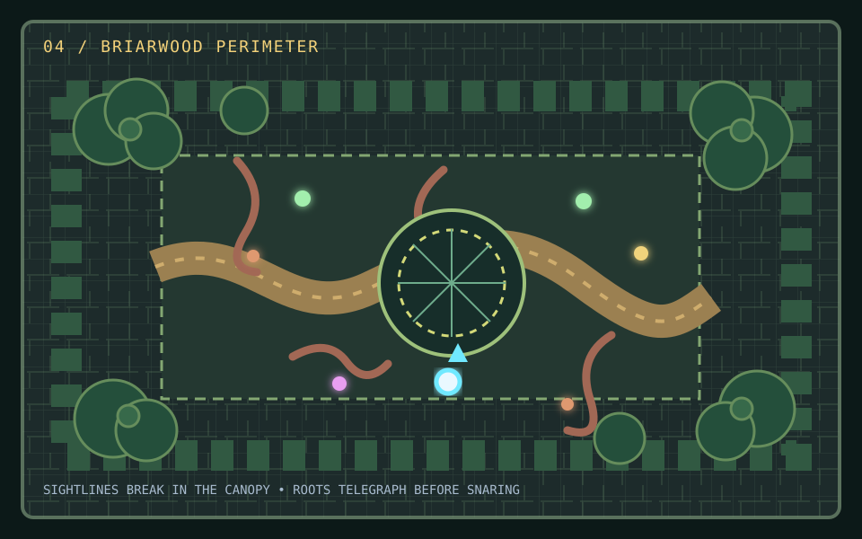
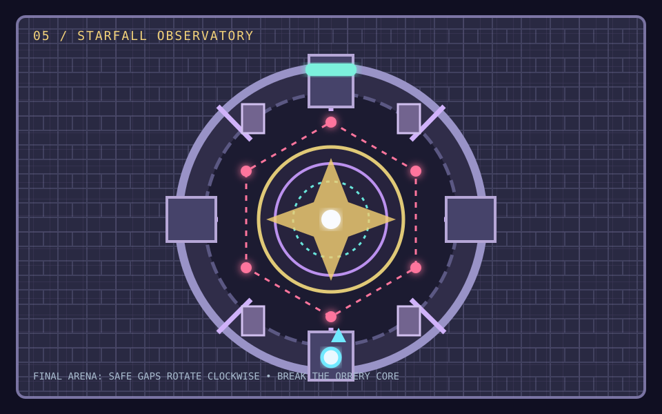

# Hex District: Curfew

An original portrait-first Android survival roguelite: one-thumb movement from the lower part of the screen, automatic attacks, escalating enemy swarms and five magical-city districts.

## Project Files

- [CONCEPT.md](CONCEPT.md) — complete game design, story, survival loop, one-handed controls, spells and five districts.
- [PROMPT_FOR_AGENT.md](PROMPT_FOR_AGENT.md) — autonomous build prompt for a coding agent; work end-to-end without asking the user for decisions.
- [HANDOFF.md](HANDOFF.md) — required persistent project status, decisions, checks and next steps for the next agent.
- [`refs/`](refs/) — five self-contained SVG concept maps.

## Level References

| District | Reference |
|---|---|
| Gloam Academy Rooftops |  |
| Lantern Ward Night Market |  |
| The Underline Metro |  |
| Briarwood Perimeter |  |
| Starfall Observatory |  |

The references are concept layouts, not final production art. The game world, characters and assets must remain original.
