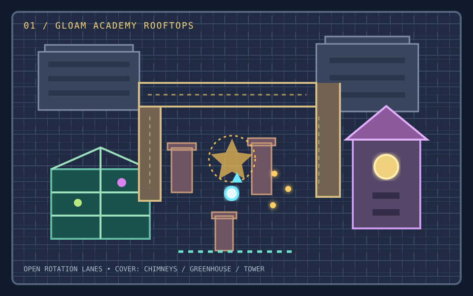
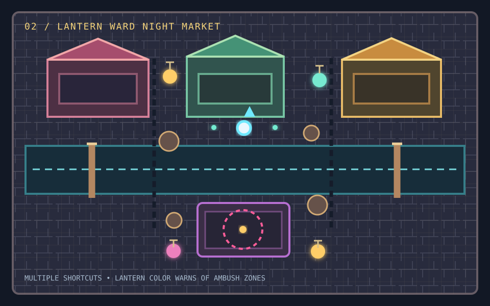
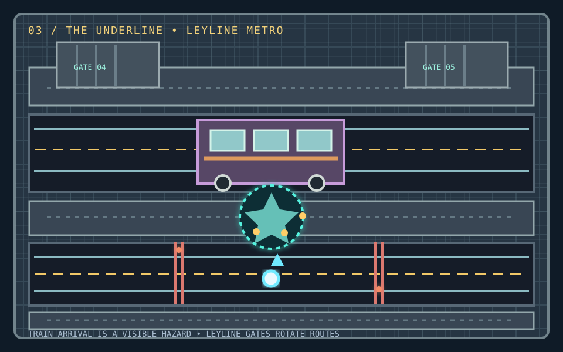

# Hex District: Curfew — пакет концепта

Оригинальный концепт Android top-down roguelite / bullet hell в ночном городе магов.

## Состав

- [CONCEPT.md](CONCEPT.md) — полный игровой концепт, сюжет, боевой цикл, механики и дизайн пяти уровней.
- [PROMPT_FOR_AGENT.md](PROMPT_FOR_AGENT.md) — мастер-промт для агента-разработчика.
- [HANDOFF.md](HANDOFF.md) — обязательная передача контекста будущему агенту.
- [refs/](refs/) — пять авторских SVG-референсов уровней.

## Референсы

| Район | Векторный референс |
|---|---|
| Крыши Академии Глоам |  |
| Ночной рынок Лантерн |  |
| Метро «Андерлайн» |  |
| Опушка Брайарвуда |  |
| Обсерватория Старопада |  |

Референсы — авторские концепт-схемы, не финальные игровые ассеты. Мир и персонажи оригинальные.